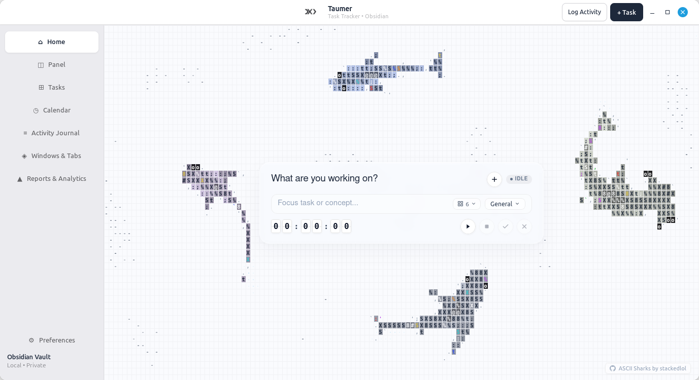
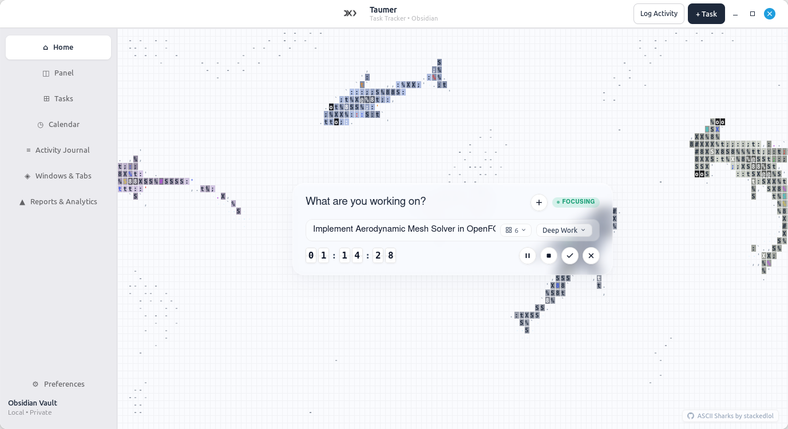
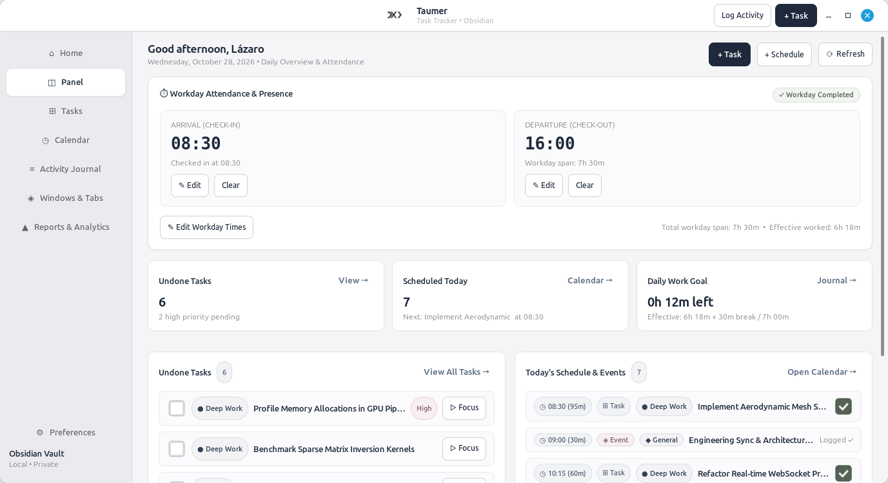
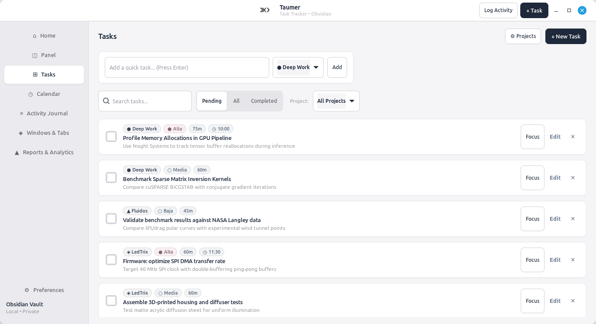
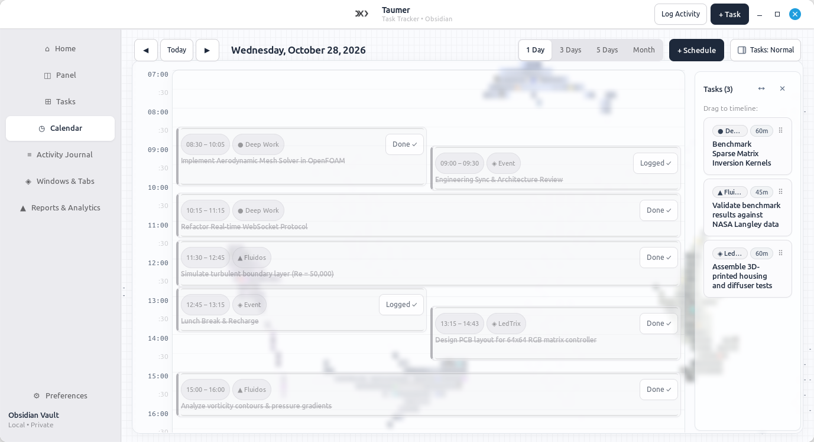
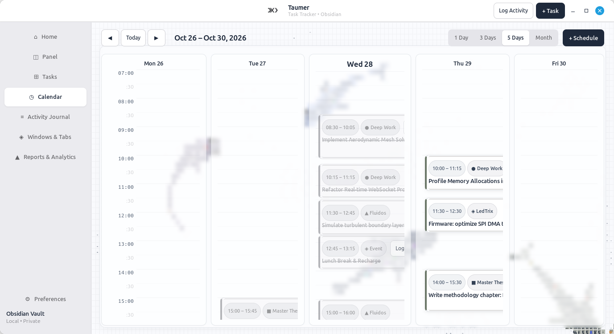
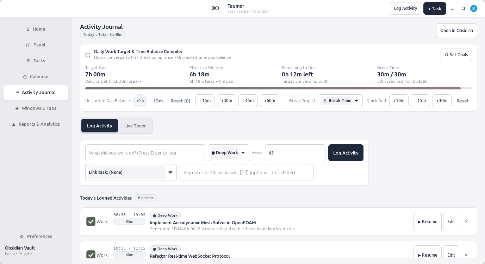
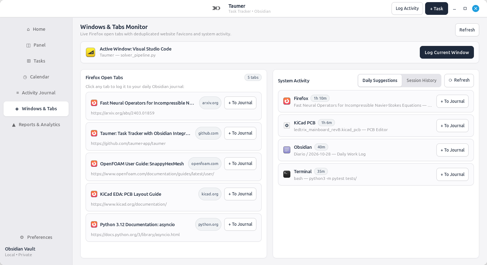
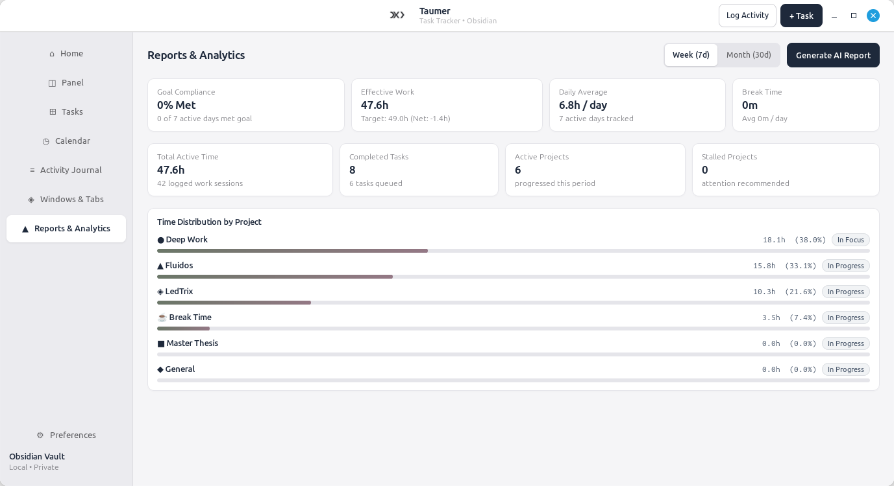

<p align="center">
  
</p>

# Taumer 🦈

<p align="center">
  <strong>Native Linux Task, Focus & Activity Tracker with Seamless Obsidian Integration.</strong>
</p>

<p align="center">
  
  
  
  
</p>

---

Taumer is a high-performance, native Linux productivity application built with **Python 3, GTK 4, Libadwaita, and WebKitGTK 6.0**. It combines deep-work focus sessions, visual time-blocking on a true-time canvas, automated window activity monitoring, and bidirectional **Obsidian Markdown** synchronization into an interface engineered around Apple Human Interface Guidelines and ASCII art aesthetics.

---

## 📸 Visual Tour & Core Workflow

Here is how Taumer unifies your daily workflow across its primary sections:

---

### 1. Minimalist Focus Space (Home)

An ambient deep-work environment featuring real-time ASCII ocean animations that keep you anchored in focus without visual fatigue.

<p align="center">
  <em>Idle Focus Capsule — Ready to start anytime:</em>
  <br />
  
</p>

<p align="center">
  <em>Active Focus Session with Running Mechanical Flap Stopwatch:</em>
  <br />
  
</p>

- **Real-Time ASCII Sharks Ocean**: GPU-accelerated ASCII simulation running seamlessly in the background (powered by [ascii-sharks](https://github.com/stackedlol/ascii-sharks)).
- **Translucent Glass Capsule**: Pick a pending task or type an open-ended concept, select the project tag, and start focusing instantly.
- **Flap Stopwatch & Quick Controls**: Mechanical-style split flap timer with pause, save, stop, and parallel secondary focus slots.

---

### 2. Daily Overview & Workday Attendance (Panel)

Your daily cockpit for attendance tracking, goal convergence, and quick task reporting.

<p align="center">
  
</p>

- **Workday Presence (Check-In & Check-Out)**: Records arrival and departure timestamps with automatic workday span calculation.
- **Convergence to Goal Target**: Real-time progress tracking toward your configured daily work target (e.g. 7h 00m target + 30m break).
- **Tiny Reports**: Instant split-view overview of pending high-priority items and today's schedule.

---

### 3. Apple-Style Task Board (Tasks)

Structured task management organized by project, priority, and time estimates.

<p align="center">
  
</p>

- **Project Categorization**: Color-coded project cards (`Deep Work`, `Fluidos`, `LedTrix`, `Master Thesis`).
- **Rich Metadata**: Priority tags (`#alta`, `#media`), estimated durations (`⏳90m`), scheduled calendar dates, and Obsidian wikilinks (`[[Project]]`).
- **Inline Quick-Add Bar**: Restrained input width for rapid task entry without disrupting your workflow.

---

### 4. True-Time Canvas Timeline (Calendar)

A modern calendar and time-blocking interface with minute-level precision across hour boundaries.

<p align="center">
  <em>1-Day View with Parallel Collision Layout & Unscheduled Tasks Drawer:</em>
  <br />
  
</p>

<p align="center">
  <em>Workweek (5-Days) Multi-Day Planning:</em>
  <br />
  
</p>

- **True-Time Minute Precision**: Accurate positioning across hour borders (e.g., 08:30 to 10:05).
- **Parallel Collision Layout**: Overlapping events and tasks automatically arrange side-by-side in equal columns.
- **Resize Gestures**: Drag the top or bottom edges of scheduled blocks to adjust start times and durations.
- **Right Tasks Drawer**: Slide-out drawer with 3-stage resizing (Normal, Wide, Closed) for drag-and-drop scheduling of unassigned backlog tasks.
- **Multi-View Modes**: Switch effortlessly between 1-Day, 3-Days, Workweek (5-Days), and Month views.

---

### 5. Activity Journal & Time Balance Compiler (Activity Journal)

A retrospective activity logger and daily work target reconciliation compiler.

<p align="center">
  
</p>

- **4-Column KPI Balance Row**:
  - **Target Goal**: Configured daily target (e.g. `7h 00m`).
  - **Effective Worked**: Pure productive focus time (e.g. `6h 18m`).
  - **Remaining to Goal**: Dynamic countdown converging to 0h (`12m left`).
  - **Break Time**: Actual break time versus break budget (`30m / 30m`).
- **Interactive Logging**: Log past activities with Obsidian markdown tags or run a live background stopwatch.
- **Chronological Feed**: Detailed breakdown of every session with project pills, durations, and timestamps.

---

### 6. Privacy-Safe Windows & Tabs Monitor (Windows & Tabs)

Effortlessly capture context from your active workspace and open browser research tabs.

<p align="center">
  
</p>

- **Active Window Banner**: Shows the currently focused desktop application and session duration.
- **Browser Tab Reader**: Displays open tabs with website favicons and domain pills.
- **1-Click Journal Sync**: Convert any open browser tab or window session directly into an Obsidian journal entry with one click.

---

### 7. Focus Analytics & AI Retrospectives (Reports & Analytics)

Longitudinal focus tracking, project distribution, and automated retrospective generation.

<p align="center">
  
</p>

- **Compliance Metrics**: Percentage of days where daily focus targets were met.
- **Project Time Distribution**: Visual breakdown of hours and percentages spent across projects.
- **AI Retrospective Generator**: One-click generation of structured Markdown reports saved directly into your Obsidian `Reportes/` folder.

---

## 📓 Bidirectional Obsidian Integration

Taumer stores its data directly inside standard, human-readable Markdown files with YAML frontmatter:

| Folder | Obsidian File | Description |
| :--- | :--- | :--- |
| `Diario/` | `YYYY-MM-DD.md` | Daily journal notes with structured YAML metadata and activity tables. |
| `Tareas/` | `tareas.md` | Task checklists organized by project headers and metadata tags. |
| `Proyectos/` | `proyectos.json` | Project definitions, icons, and Obsidian wikilinks (`[[Project]]`). |
| `Reportes/` | `Reporte-Semana-*.md` | Weekly and monthly retrospective summaries. |

Changes made in Obsidian or Taumer sync seamlessly without lock-in or proprietary databases.

---

## 🛠️ Requirements & System Dependencies

Taumer is natively built for Linux (Linux Mint, Ubuntu, Debian, Fedora, and Arch).

### Debian / Ubuntu / Linux Mint:
```bash
sudo apt update
sudo apt install -y \
    python3 \
    python3-gi \
    python3-gi-cairo \
    gir1.2-gtk-4.0 \
    gir1.2-adw-1 \
    gir1.2-webkit-6.0 \
    x11-utils \
    python3-yaml \
    python3-requests \
    python3-pil
```

---

## 🚀 Installation & Quick Start

1. **Clone the repository:**
   ```bash
   git clone https://github.com/lazaro-guerrero-losada/Taumer.git
   cd Taumer
   ```

2. **Install desktop shortcut and CLI command:**
   ```bash
   ./install.sh
   ```
   This registers Taumer in your application menu and adds the `taumer` terminal launcher.

3. **Or run directly:**
   ```bash
   ./run.sh
   ```

---

## 📂 Project Structure

```text
├── app/
│   ├── main.py              # Application entry point & GTK lifecycle
│   ├── config.py            # Global paths, vault locations & settings
│   ├── models.py            # Task, JournalEntry, and Project dataclasses
│   ├── storage.py           # Obsidian Markdown parser and JSON sync
│   ├── watcher.py           # Native X11 window activity tracker
│   ├── agent.py             # Retrospective analytics compiler
│   ├── style.css            # Custom styling & minimalist typography
│   ├── taumer.svg / .png    # Official application brand marks
│   └── ui/
│       ├── main_window.py   # Application window & navigation shell
│       ├── shark_home_view.py # ASCII Shark focus view (WebKit6)
│       ├── home_view.py     # Workday attendance & panel dashboard
│       ├── calendar_view.py # True-time canvas timeline calendar
│       ├── tasks_view.py    # Task management and project lists
│       ├── journal_view.py  # Daily timeline & activity reconciliation
│       ├── watcher_view.py  # Window usage & browser tab tracker
│       ├── reports_view.py  # Retrospective reports view
│       └── dialogs.py       # Task creation, completion & settings modals
├── screenshots/             # High-resolution application screenshots
├── install.sh               # Desktop application installer
├── taumer.desktop           # Linux Desktop Entry file
├── run.sh                   # Main executable launcher
├── requirements.txt         # Python dependencies
└── README.md
```

---

## 🙏 Credits & Acknowledgments

- **ASCII Sharks Animation**: Interactive ASCII shark canvas adapted from [stackedlol/ascii-sharks](https://github.com/stackedlol/ascii-sharks).

---

## 📄 License

MIT License. See [LICENSE](LICENSE) for details.
